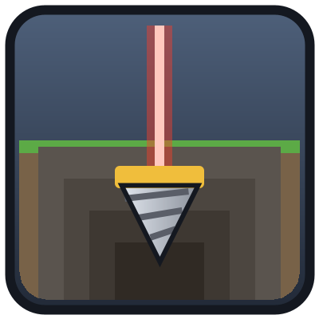

# Voltworks Quarry

An expansion for [Voltworks Industrial](https://github.com/chrisbrady86/voltworks-industrial) (Minecraft **26.3**, Fabric). Install it alongside Voltworks Industrial (it is required) and it adds a powered **Quarry** that digs out a square pit, layer by layer, down to bedrock.



## Features

- **Quarry** (tier 2): digs the 9×9 area *behind* it (its front faces you when placed), from its own height down to the bottom of the world.
  - Runs on Voltworks power through Copper Cable: **20 J/t** while digging, 20,000 J buffer, front charge gauge.
  - Harder blocks take longer (dirt 5 ticks, stone 8, deepslate 12, obsidian 153).
  - Bedrock and other unbreakable blocks are skipped. Water and lava are cleared. Chests in the way are emptied into the output; nothing spills into the pit.
  - 18 output slots. It pushes items into any adjacent chest by itself, and Voltworks item pipes pull from it like any other machine. If everything is full, it waits.
  - A redstone signal pauses it.
  - While it digs, a steel gantry frames the pit: a bridge and carriage follow the row being dug, and a shaft lowers a spinning drill head onto the block it's mining, with breaking cracks.
  - Its screen shows a map of the current layer (dug, still to dig, the drill) and a depth gauge down to the bottom of the world.
  - Works with the Voltworks wrench: rotate it, configure sides, sneak + right-click to pick it up.
- **Quarry Marker**: to dig somewhere other than the square behind the quarry, put one marker touching the quarry and another at the opposite corner. The quarry picks both up and digs the rectangle between them (corners included), from its own height down. The area can be up to 9 wide and long, or 17 / 25 / 33 with Range Upgrades; if Range Upgrades are taken out later, it stops with "Area too big". Right-click a marker to see which marker it pairs with. Keep cables and chests outside the marked area.
- **Upgrades** (three slots, shared with Voltworks' Speed / Capacity / Ejector upgrades):
  - **Range Upgrade**: +8 blocks wide each (9×9 → 17×17 → 25×25 → 33×33).
  - **Fortune Upgrade**: one Fortune level each, up to III; +50% power per level.
  - **Silk Touch Upgrade**: blocks drop themselves; double power. Overrides Fortune.
- Fits into Voltworks: its items are in the Voltworks creative tab, the **Voltworks Guide** gets Quarry pages at the end (from `tools/guide.txt`), and with JEI installed every quarry item has an info page.

Turning the quarry or changing its range restarts it from the top; air it already dug out is skipped quickly. It only works while its chunks are loaded.

## Recipes

- Quarry: steel, circuits, two diamond pickaxes, an Advanced Machine Frame and a Power Cell.
- Quarry Marker (2): a redstone torch on a tin ingot.
- Upgrades: tin + circuit + redstone around an Ender Pearl (Range), a Lapis Block (Fortune) or an Emerald (Silk Touch).

## Building and running

Needs JDK 25 (path in `gradle.properties`) and a built Voltworks jar. The addon compiles against `../voltworks/build/libs/voltworks-0.2.0.jar` (set by `voltworks_jar` in `gradle.properties`), so build Voltworks first:

```bash
cd ../voltworks && ./gradlew build
cd ../voltworks-quarry && ./gradlew build
./gradlew runClientGameTest   # automated in-world test, expect "ALL CHECKS PASSED"
```

To play: put `voltworks-quarry-<version>.jar`, Voltworks Industrial 0.2.x and Fabric API in your `mods` folder. Voltworks Quarry 0.1.x works with Voltworks Industrial 0.2.x; with any other version (or without it) the game stops at startup with a message saying which version is needed. JEI is optional.

## Automated test

`src/gametest/.../QuarryClientGameTest.java` builds eight quarries in the sky above spawn and runs 900 ticks:
fortune quarry (stone, iron ore, a chest of diamonds, bedrock, water, a dirt layer — all dug, bedrock kept, chest contents collected, nothing spilled, output pushed into the chest on top), silk touch quarry, a redstone-paused quarry, an unpowered quarry, a 17×17 Range quarry, a quarry with a marked 5×4 area (only that area dug, markers picked up), a marked 13×13 area that becomes "Area too big" when its Range Upgrade is removed, and markers too far apart to pair. Screenshots go to `build/run/clientGameTest/screenshots/`.

## Assets

Everything in `src/main/resources` (textures, models, blockstates, recipes, loot, tags, translations, guide pages, icon) is generated:

```bash
java tools/GenAssets.java src/main/resources
```

The quarry's sides and charge gauge reuse Voltworks' own textures and models. All art is original.

## License

MIT — see [LICENSE](LICENSE).
