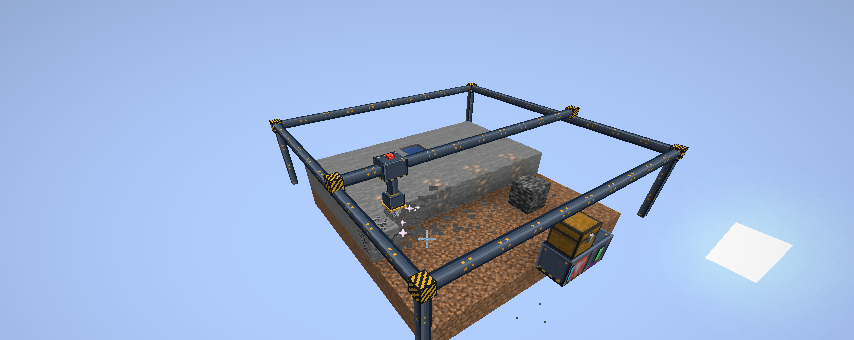
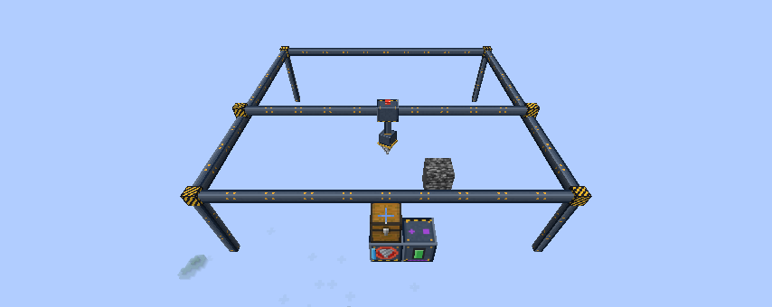
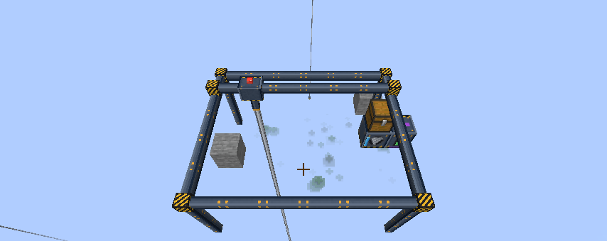
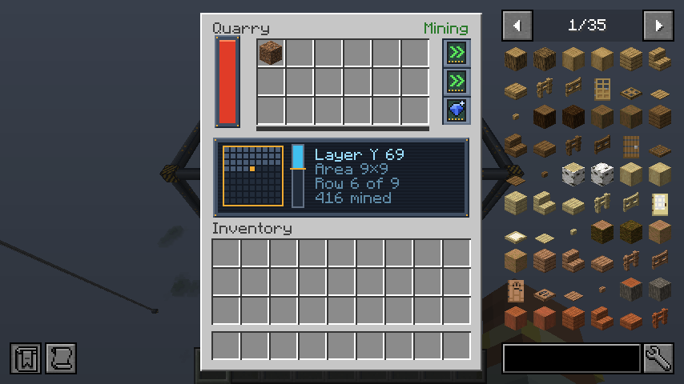

# CurseForge release kit (Voltworks Quarry)

Everything needed to create the Voltworks Quarry project and upload the first file. Copy the fields below into the CurseForge author console. Voltworks Industrial must already be on CurseForge, because this project lists it as a required dependency.

## Project settings

| Field | Value |
|---|---|
| Name | Voltworks Quarry |
| Summary (one line) | A powered quarry expansion for Voltworks Industrial: digs a square pit to bedrock, with Range, Fortune and Silk Touch upgrades. |
| Game / type | Minecraft / Mods |
| Main category | Technology |
| Extra categories | Addons, Energy |
| License | MIT License |
| Logo | `docs/images/logo.png` (400×400) |
| Screenshots (Images tab) | From `docs/images/`: `quarry-digging.png`, `quarry-gantry.png`, `quarry-marked-area.png`, `quarry-gui.png` |
| Source link | https://github.com/chrisbrady86/voltworks-quarry |
| Issues link | https://github.com/chrisbrady86/voltworks-quarry/issues |

The description below shows these same pictures straight from the GitHub repo (`raw.githubusercontent.com/.../main/docs/images/...`), so they appear once the images are pushed to GitHub.

## First file upload

| Field | Value |
|---|---|
| File | `build/libs/voltworks-quarry-0.1.0.jar` (not the `-sources` jar) |
| Display name | Voltworks Quarry 0.1.0 |
| Release type | Beta |
| Game version | 26.3 |
| Mod loader | Fabric |
| Java version | Java 25 |
| Environment | Client and Server |
| Related projects | **Voltworks Industrial** — Required Dependency · **Fabric API** — Required Dependency · **JEI** — Optional Dependency |
| Changelog | See below |

The launcher installs Required Dependencies for the player, so marking Voltworks Industrial as required is what makes this an expansion people can install in one click.

### Changelog for 0.1.0

```
First release. Requires Voltworks Industrial 0.2.x.
- Quarry: digs the 9x9 area behind it, layer by layer, down to bedrock, on Voltworks power (20 J/t)
- Quarry Markers: mark any rectangle (up to the Range Upgrade limit) for the quarry to dig instead
- Skips bedrock, clears water and lava, empties chests in the way into its output
- Fills adjacent chests by itself; Voltworks item pipes pull from it; redstone pauses it
- Upgrades: Range (up to 33x33), Fortune (I-III), Silk Touch; also takes Voltworks Speed, Capacity and Ejector upgrades
- A steel gantry frames the pit while it works: a bridge and carriage follow the dig, with a shaft down to a spinning drill head
- Quarry screen with a map of the current layer and a depth gauge
- Adds Quarry pages to the Voltworks Guide; JEI info pages when JEI is installed
```

## Project description (paste into the description editor, Markdown mode)

```markdown
# Voltworks Quarry

**An expansion for [Voltworks Industrial](https://www.curseforge.com/minecraft/mc-mods/voltworks-industrial).** Plug a Quarry into your power grid and let it dig a pit all the way down to bedrock while you get on with building.



## ⛏️ The Quarry
- Place it, and it digs out the **9×9 area behind it**, layer by layer, from its own height down to the bottom of the world.
- Runs on **Voltworks power** through Copper Cable: 20 J/t while it digs. Harder blocks take longer.
- **Bedrock** is skipped, **water and lava** are cleared, and **chests** in the way are emptied into its output. Nothing spills into the pit.
- Put a **chest next to it** and it fills it by itself. Voltworks **item pipes** pull from it too, so you can send ores straight to your Crushers.
- A **redstone signal** pauses it.
- While it works, a **steel gantry** frames the pit: a bridge and carriage follow the dig, and a shaft lowers a **spinning drill head** onto each block.
- Its screen shows a **map of the current layer** and a **depth gauge**, so you can see how far down it is at a glance.
- Works with the Voltworks **Wrench**: rotate it, set its sides, pick it up.
- Want it somewhere else? Place a **Quarry Marker** touching the quarry and another at the opposite corner: it digs the rectangle between them instead.







## 🔧 Upgrades
| Upgrade | Effect |
|---|---|
| Range | +8 blocks wide each: 9×9 → 17×17 → 25×25 → 33×33 |
| Fortune | One Fortune level each, up to III (+50% power per level) |
| Silk Touch | Blocks drop themselves (double power) |

The Voltworks **Speed**, **Capacity** and **Ejector** upgrades work in the quarry too.

## 📖 Fits right in
The quarry shows up in the Voltworks creative tab, adds its own pages to the **Voltworks Guide**, and has info pages in **JEI**.

## Requirements
- Minecraft 26.3, Fabric Loader
- [Voltworks Industrial](https://www.curseforge.com/minecraft/mc-mods/voltworks-industrial) 0.2.x
- [Fabric API](https://www.curseforge.com/minecraft/mc-mods/fabric-api)
- JEI (optional)

The quarry only digs while its chunks are loaded. Modpacks: yes, go ahead! Voltworks Quarry is MIT licensed.
```

## Before you click upload

- [ ] Publish Voltworks Industrial 0.2.0 first
- [ ] Build Voltworks, then `./gradlew build` here, and take the fresh jar from `build/libs/`
- [ ] Check the Voltworks Industrial CurseForge link above matches its real project URL
- [ ] Test the jar once in a normal Minecraft install (Fabric Loader + Fabric API + Voltworks Industrial) to be sure it loads outside the dev environment
